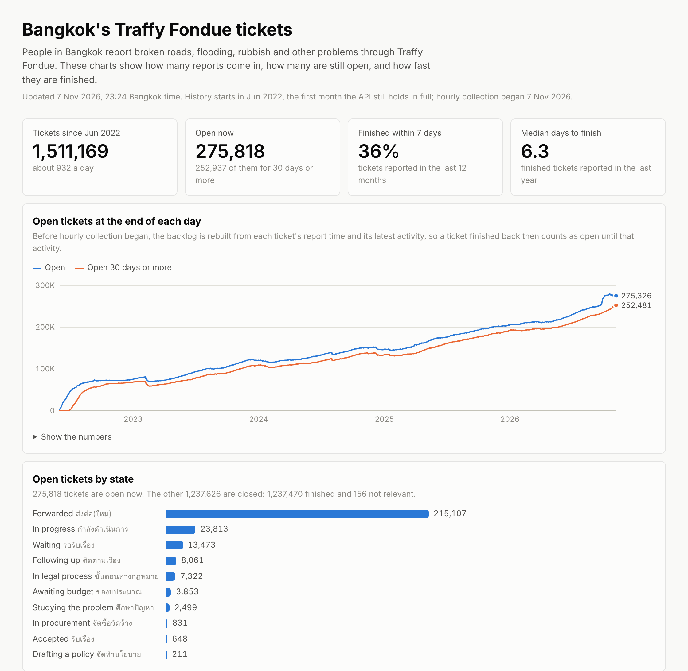
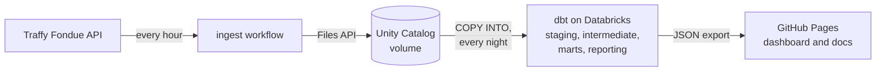

# Bangkok Traffy Fondue warehouse

People in Bangkok report broken roads, flooding, rubbish and other city problems through Traffy
Fondue, and the city's public API shows where each report stands now. It keeps no history, so this
project pulls the reports that changed every hour, keeps every version it sees, and models them
with dbt on Databricks Free Edition to measure how long the city takes to fix things, by district
and by type of problem.

The results are on a [dashboard](https://tongthong-nnk.github.io/bkk-traffy-warehouse/) rebuilt
every night, next to the [model documentation](https://tongthong-nnk.github.io/bkk-traffy-warehouse/docs/).

[](https://tongthong-nnk.github.io/bkk-traffy-warehouse/)

On 7 November 2026 the warehouse held 1,513,444 tickets, about 930 a day since June 2022.
275,818 were open, 92% of them for 30 days or more, and 215,107 of the open ones were still
marked forwarded (ส่งต่อ(ใหม่)). The share finished within 7 days rose from 32% for tickets
reported in 2022 to 42% in 2024 and is 36% for the past 12 months; the median finished ticket
from the past year took 6.3 days. Times for tickets finished before collection began run to their
last activity, so they lean long.



| Folder | What is in it |
|---|---|
| `ingest/` | the pull from the API and the upload to Databricks, in Python |
| `dbt/` | models, seeds, macros and tests |
| `dashboard/` | the page and the script that exports its data |
| `.github/workflows/` | `ingest` (hourly), `backfill`, `build` (nightly) and `ci` |

## Ingest

`python -m ingest pull` reads every report whose last activity falls on yesterday or today in
Bangkok time, one day and 1,000 tickets per request, and writes one gzipped JSON Lines file per page
and a manifest for the run. The API slows down as a window grows (a page from one month of 2024 took
19 s, a page from two days of November 2026 took 6.5 s), so even a backfill asks for one day at a
time. Reading two days on every run means a late or skipped hourly run loses nothing; the
repeats are removed later, in `int_ticket_versions`. The reporter's text, officers' notes and photo
links are dropped before anything is written, because nothing downstream needs them.

`python -m ingest upload out` copies the files into the Unity Catalog volume
`workspace.traffy.landing` through the Databricks Files API, which needs no cluster or SQL
warehouse. Manifests go last, so a manifest in the volume means every page of its run is there too.

The `ingest` workflow runs both every hour at minute 17. The `backfill` workflow loads the history
the API still holds, back to May 2022, by running the same ingest once per year.

## Models

`dbt/` is a dbt project for Databricks SQL. The build workflow runs it every night.

| Layer | Models | What happens there |
|---|---|---|
| raw | `raw_tickets`, `raw_runs` | `COPY INTO` copies new files from the volume, one row per line, unparsed |
| staging | `stg_traffy__ticket_snapshots`, `stg_traffy__runs` | JSON parsed into typed columns; the district is read from the address |
| intermediate | `int_ticket_versions`, `int_tickets`, `int_ticket_state_periods` | repeated snapshots dropped (incrementally), then each ticket's versions turned into the time it spent in each state |
| marts | `fct_ticket`, `fct_state_change`, `fct_backlog_daily`, `dim_date`, `dim_district`, `dim_state`, `dim_problem_type`, `bridge_ticket_problem_type` | a star schema with one fact table of each kind: accumulating snapshot, transaction and periodic snapshot |
| reporting | `rpt_summary`, `rpt_monthly`, `rpt_backlog_daily`, `rpt_district`, `rpt_state`, `rpt_problem_type`, `rpt_data_quality` | small tables shaped for the dashboard |

A ticket reported before collection began was seen only in its latest state. The time between its
report and that state is kept as period 0 with state `unknown`, and `fct_ticket.observed_from_start`
says which tickets were seen from the report onwards, so durations can be filtered to the ones that
were measured rather than inferred.

The API names states in Thai, and it has used twelve of them since 2022. The `ticket_states`
seed gives each one a code and says whether it counts as open. Two states close a ticket,
`finished` (เสร็จสิ้น) and `not_relevant` (ไม่เกี่ยวข้อง), and only `finished` counts towards the
time to finish. A state the seed does not list yet counts as `other` and open, and the build warns
about it until a row is added.

After the build, `dashboard/export.py` writes the reporting tables to JSON, and the workflow pushes
them to the `gh-pages` branch with the page in `dashboard/` (plain HTML, CSS and JavaScript, no
build step) and the dbt docs.

## Tests

Every build runs the dbt data tests (keys, and relationships to the seeds and dimensions), then
five unit tests on the models with the most logic: repeat removal, state periods, ticket
milestones and the daily backlog. `dbt source freshness` fails the build when no pull has finished
for 12 hours. On every push, CI runs ruff, the ingest tests (paging, retries, upload order) and
`dbt parse`.

## Problems in the data

Counts are from the build of 7 November 2026. `rpt_data_quality` counts most of them again on
every build, and the dashboard lists them.

- The API keeps only each ticket's current state. Everything before hourly collection began on
  7 November 2026 comes from the backfill, which saw each ticket once: the time from its report to
  its last activity is kept as period 0, `unknown`, and a ticket that was already finished counts
  as closed at its last activity, which can come after the real close (a rating after the fix
  moves it). Durations are measured rather than inferred only for tickets with
  `observed_from_start`: 7,672 so far.
- Its history starts on 24 May 2022, the oldest last activity it returns, so a ticket reported
  before then is there only if something happened to it later. Just 2,275 tickets are from
  before June 2022, the first from September 2021, so the dashboard's charts start in June 2022,
  the first complete month.
- No ticket reported since December 2025 has a category: for all 387,744 of them, finished or
  not, the API's `type` and `problem_type_abdul` are empty. Before November 2025, 15% had none.
  The category chart shows the drop rather than hiding it.
- Paging through a window returns fewer tickets than the `total` on its first page. For
  6 November 2026 the first page said 4,734, and the page at offset 4,720 came back empty. Across
  the backfill and the hourly pulls, 27,299 of 1,570,212 tickets (1.7%) are missing this way. A
  page past the end, like an empty window, reports `total: null`.
- The API takes longer to answer the more tickets a window holds, so the ingest asks for one day
  at a time. The backfill took 2,577 requests and about three hours.
- The seed started with four states; the other eight turned up once real data came in, among
  them procurement (จัดซื้อจัดจ้าง) and legal process (ขั้นตอนทางกฎหมาย).
- 113,981 tickets (7.5%) have an address that names no Bangkok district, some because they are
  outside Bangkok altogether, so they count under no district. Matching coordinates to district
  boundaries would place the ones inside Bangkok.
- 518 tickets have a last activity earlier than their report time.

## Running it yourself

Everything runs on free plans: Databricks Free Edition, and GitHub Actions, which costs nothing
for a public repository.

1. Sign up for [Databricks Free Edition](https://www.databricks.com/learn/free-edition). From the
   SQL warehouse it comes with, copy the server hostname and HTTP path (Connection details), and
   create a personal access token (Settings > Developer > Access tokens).
2. In the repository's Settings > Secrets and variables > Actions, add the token as the secret
   `DATABRICKS_TOKEN`, and the hostname and HTTP path as the variables `DATABRICKS_HOST` and
   `DATABRICKS_HTTP_PATH`.
3. Run the `build` workflow. Its first run creates the schema, the landing volume and the raw
   tables, then stops at the freshness check because nothing has been pulled yet. Run `backfill`
   next; from then on `ingest` runs every hour and `build` every night at 02:45 Bangkok time.
4. Under Settings > Pages, deploy from the `gh-pages` branch.

To work on the ingest locally:

```sh
pip install -e ".[dev]"
pytest
python -m ingest pull --out out --start 2026-11-05 --end 2026-11-05
```

## Data

Reports come from the Traffy Fondue public API for the Bangkok Metropolitan Administration
(`publicapi.traffy.in.th`). This repository publishes only counts and durations, never single
reports.
